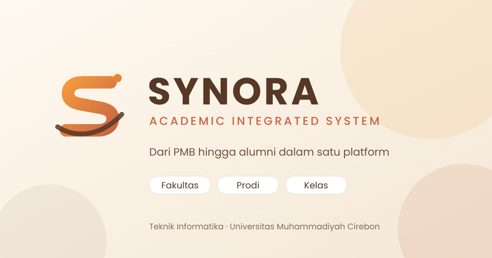

<div align="center">


# SYNORA Academic Integrated System

**Sistem informasi akademik terpadu multi-fakultas: dari PMB hingga alumni.**
Universitas Muhammadiyah Cirebon · Proyek Pemrograman Berbasis Platform · Kelompok 3 · TI24D

[](https://github.com/nadhiyaauliyah45-hue/synora-academic)
[](#teknologi)

</div>

**Repositori:** https://nadhiyaauliyah45-hue.github.io/synora-academic/



## Tentang proyek

SYNORA bermula dari aplikasi pengelolaan kelas TI24D, lalu dikembangkan menjadi satu platform untuk seluruh siklus mahasiswa (PMB, perkuliahan, keuangan, praktikum, skripsi, kelulusan, alumni) dan diperluas menjadi **multi-fakultas**: 7 fakultas dan 22 program studi UMC dalam satu database, dengan data yang dibatasi per fakultas dan prodi.

## Fitur utama

**Akademik**
- PMB per program studi: periode, pendaftar, berkas, seleksi (kuota), registrasi ulang yang menghasilkan NIM.
- KRS (maks. 24 SKS), persetujuan, input nilai dosen (bobot 10/20/30/40), KHS, IPS dan IPK dari nilai final.
- Tagihan dan pembayaran (unggah bukti, verifikasi Admin Keuangan), praktikum dan lab, skripsi, kelulusan, dan alumni.
- Siklus hidup mahasiswa dengan riwayat status yang tidak dapat dipalsukan dari klien.
- Dashboard akademik per prodi dan fakultas, dengan ekspor PDF dan Excel.

**Multi-fakultas**
- 13 peran: `km`, `sekretaris`, `bendahara`, `dosen`, `super_admin`, `admin_universitas`, `dekan`, `kaprodi`, `admin_prodi`, `admin_pmb`, `admin_keuangan`, `mahasiswa`, `asisten_lab`.
- Cakupan akses per staf (tabel `user_scopes`): universitas, fakultas, atau program studi. Kaprodi TI tidak dapat melihat data Akuntansi. Ditegakkan di database lewat RLS.
- **Kalender bertingkat:** kelas, prodi, fakultas, universitas. Agenda tingkat atas tampil ke bawah dan tidak dapat diubah oleh tingkat di bawahnya.
- Pengelolaan akun hanya oleh Super Admin (Edge Function `admin-users`, kunci layanan hanya di server).

**Modul kelas (TI24D):** absensi, kas dan inventaris, mata kuliah, perpustakaan, memories, kalender, ruang komunikasi (realtime), Class Spin.

## Teknologi

| Bagian | Yang dipakai |
|---|---|
| Antarmuka | HTML5, CSS3, JavaScript murni (ES Modules), **tanpa framework** |
| Backend | Supabase: PostgreSQL, Auth, Storage, Realtime, Edge Functions |
| Keamanan | Row Level Security, hak akses kolom, fungsi `security definer` |
| Pustaka | Supabase JS, jsPDF + AutoTable, SheetJS, Bootstrap Icons (semua di `vendor/`), font Poppins |

## Struktur folder

```
index.html, dashboard.html   Halaman masuk dan dasbor kelas
pages/                       19 halaman modul
js/                          Logika per modul (config.js, permissions.js, dst.)
css/                         Gaya tampilan
vendor/                      Pustaka lokal
assets/                      Logo, ikon, gambar
database/                    SQL: schema, migrasi 010-095, seed-umc.sql
supabase/functions/admin-users/   Edge Function pengelolaan akun
```

## Cara menjalankan

1. **Clone**
   ```bash
   git clone https://github.com/nadhiyaauliyah45-hue/synora-academic.git
   cd synora-academic
   ```
2. **Konfigurasi** `js/config.js`: isi `SUPABASE_URL` dan kunci publishable (anon). **Jangan** menaruh kunci `service_role` di frontend.
3. **Database** (Supabase → SQL Editor, berurutan):
   `database/schema.sql` → `relationships.sql` → `rls-policies.sql` → `synora-academic-FULL-migrasi.sql` (atau migrasi 010 s.d. 095 satu per satu, **085 sebelum 090**) → `seed-umc.sql` (periksa daftar fakultas dan prodi dulu). Semua skrip aman dijalankan ulang. Rincian di `database/run-all.sql.md`.
4. **Akun pertama:** buat pengguna di Authentication (email `NIM@synora.local`, centang Auto Confirm), lalu jalankan `database/bootstrap-admin.sql` (role `super_admin`).
5. **Edge Function:**
   ```bash
   npx supabase login
   npx supabase link --project-ref <PROJECT_REF>
   npx supabase functions deploy admin-users
   ```
6. **Jalankan lokal** (jangan klik ganda `index.html`, modul JS butuh server):
   ```bash
   npx serve .
   ```
7. **Atur cakupan staf** di Pengaturan → Manajemen Pengguna (Kaprodi, Admin Prodi, dan Admin PMB wajib satu prodi; Dekan satu fakultas; Admin Keuangan satu prodi atau fakultas; Super Admin dan Admin Universitas tanpa cakupan). Staf tanpa cakupan tidak melihat data apa pun.

## Deploy ke GitHub Pages

Settings → Pages → Branch `main`, folder `/ (root)`. Alamat: `https://nadhiyaauliyah45-hue.github.io/synora-academic/`. Pastikan folder `js/`, `vendor/`, `css/`, dan `assets/` ikut ter-push.

## Aturan akademik bawaan

Bobot nilai 10/20/30/40 (kehadiran/tugas/UTS/UAS), skala A ≥ 85 sampai E < 40, maksimal 24 SKS per semester, syarat lulus 144 SKS dan IPK 2,00 (ubah di `app_settings`), lulus tepat waktu dalam 4 tahun. Persentase kelulusan selalu menyebut pembaginya: dari terdaftar, atau dari yang selesai (lulus + mengundurkan diri + DO).

## Batasan saat ini

- Belum ada pendaftaran PMB mandiri untuk publik (PMB dioperasikan Admin PMB) dan belum ada payment gateway.
- Modul kelas lama (absensi, kas, inventaris, perpustakaan, memories, chat) masih satu kelas (TI24D).
- Daftar fakultas dan prodi di `seed-umc.sql` berasal dari data kelompok dan perlu diverifikasi.
- Tidak ada data dummy: semua tabel dimulai kosong.
- Status pengujian: migrasi diuji di PostgreSQL 16 lokal dan halaman diuji di browser dengan API tiruan. **Belum diuji langsung pada proyek Supabase.**

## Tim

Kelompok 3, Kelas TI24D, Semester 5, S1 Teknik Informatika, Fakultas Teknik, Universitas Muhammadiyah Cirebon. Dosen pengampu: Dr. Sugiyanto.

| No | Nama | NIM |
|---|---|---|
| 1 | Haris Rizki Saefullah | 240511047 |
| 2 | Salwa Della Amalia | 240511150 |
| 3 | Najwa Pinasti | 240511153 |
| 4 | Nadhiya Auliyah Ramadhani | 240511160 |
| 5 | Rimawati | 240511184 |
